# EstateOps back end: architecture

Scope: seven deployables (one gateway, six domain services) over PostgreSQL, built to carry
100K users. This file is the design the code follows. The business meaning of every rule is in
`/CLAUDE.md` (common domain) and `Backend/CLAUDE.md` (what the back end enforces).

## 1. Goals and non-functional targets

| Goal         | Target                                                                                 |
| ------------ | -------------------------------------------------------------------------------------- |
| Users        | 100K registered, about 10% concurrent (10K)                                            |
| Throughput   | about 1K requests/s peak, p95 under 300 ms for reads and 500 ms for payments           |
| Data         | about 1M bookings, 36M invoices, 20M payments, growing                                 |
| Availability | no single point of failure above the database; any service can be redeployed alone     |
| Consistency  | strong inside a service (one transaction), eventual between services (seconds)         |
| Safety       | tenant isolation on every row, idempotent writes, append-only audit, money as integers |

## 2. System context and containers

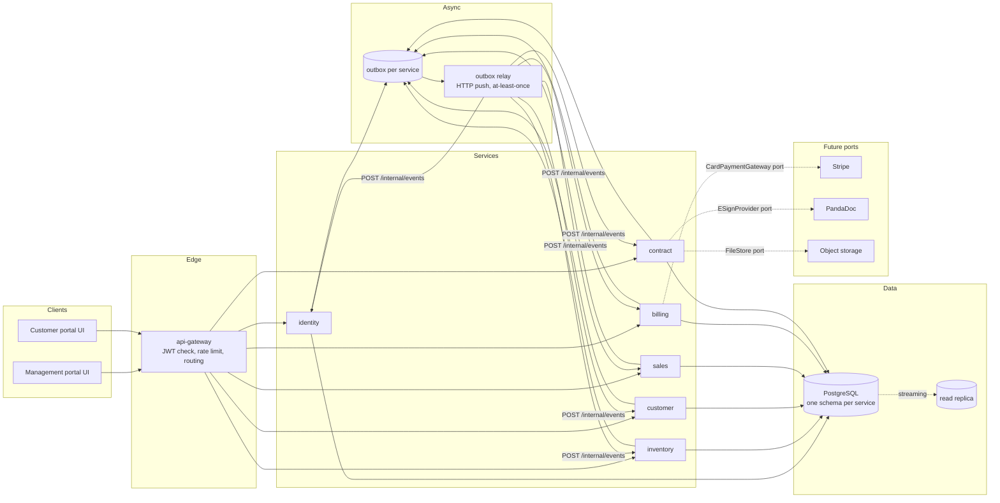

Every service is stateless. It owns one PostgreSQL schema, exposes REST, accepts events on
`POST /internal/events`, and writes events to its own outbox in the same transaction as its data.

## 3. Service catalogue

| Service     | Port | Schema      | Owns                                                                                       |
| ----------- | ---- | ----------- | ------------------------------------------------------------------------------------------ |
| api-gateway | 8080 | none        | routing, JWT check, rate limit, request id, CORS                                           |
| identity    | 8101 | `identity`  | tenants, users, roles, role permissions, permission catalog, refresh tokens, login history |
| inventory   | 8102 | `inventory` | projects, phases, blocks, floors, units, status history, media                             |
| customer    | 8103 | `customer`  | customers and their money summary                                                          |
| sales       | 8104 | `sales`     | payment plans, bookings and booking summary                                                |
| billing     | 8105 | `billing`   | invoices, payments, fine rules, escalation notices, counters, collection settings          |
| contract    | 8106 | `contract`  | contracts, versions, file metadata                                                         |

Shared packages: `kernel` (pure: errors, money, dates, state machines, clock, cursor, consumer
guard), `contracts` (event names and Zod payload schemas), `platform` (Express, TypeORM, JWT,
outbox, relay, idempotency, pagination, config, logger, test helpers).

Rule: no service imports another service. Cross-service knowledge is a small local `*_ref`
table fed by events (for example `billing.unit_ref`) so a request never waits on another service.

## 4. Event catalogue

Envelope: `{ id, type, tenant_id, occurred_at, producer, version: 1, data }`. Delivery is
at-least-once and may reorder; every consumer is idempotent (`processed_event` primary key) and
order-safe (monotonic `seq` or upsert-by-id).

| Event                     | Producer  | Consumers                                     | Key data                                                    |
| ------------------------- | --------- | --------------------------------------------- | ----------------------------------------------------------- |
| `tenant.upserted`         | identity  | inventory, customer, sales, billing, contract | slug, name, currency, locale, time zone, area unit          |
| `project.upserted`        | inventory | billing                                       | project id, name, kind                                      |
| `unit.upserted`           | inventory | sales, billing                                | unit id, project, unit no, kind, status, list price         |
| `customer.upserted`       | customer  | sales, billing                                | customer id, name, phone, email                             |
| `booking.requested`       | sales     | inventory                                     | booking id, unit id                                         |
| `unit.booked`             | inventory | sales                                         | booking id, unit id                                         |
| `unit.booking_rejected`   | inventory | sales                                         | booking id, reason                                          |
| `booking.confirmed`       | sales     | billing, contract                             | booking, unit, customer, plan snapshots, price, booked date |
| `schedule.created`        | billing   | sales                                         | booking id, invoice count                                   |
| `booking.summary_changed` | billing   | sales, customer                               | booking id, `seq`, counts and amounts, escalated            |
| `booking.fully_paid`      | billing   | sales                                         | booking id                                                  |
| `booking.completed`       | sales     | inventory                                     | booking id, unit id                                         |
| `booking.cancelled`       | sales     | inventory, billing, contract                  | booking id, unit id                                         |
| `payment.recorded`        | billing   | (audit, future reporting)                     | payment id, invoice id, amount, source                      |
| `fine_rate.changed`       | billing   | billing (worker)                              | scope, scope id, unit kind                                  |
| `contract.status_changed` | contract  | (future)                                      | contract id, booking id, status                             |

Dead letters: the relay retries with exponential backoff (500 ms doubling to 5 min), and after 10
attempts moves the row to `dead_letter` status for an operator. Consumers answer 2xx only after
their transaction commits.

## 5. Flows

### 5.1 Booking saga (choreography with compensation)

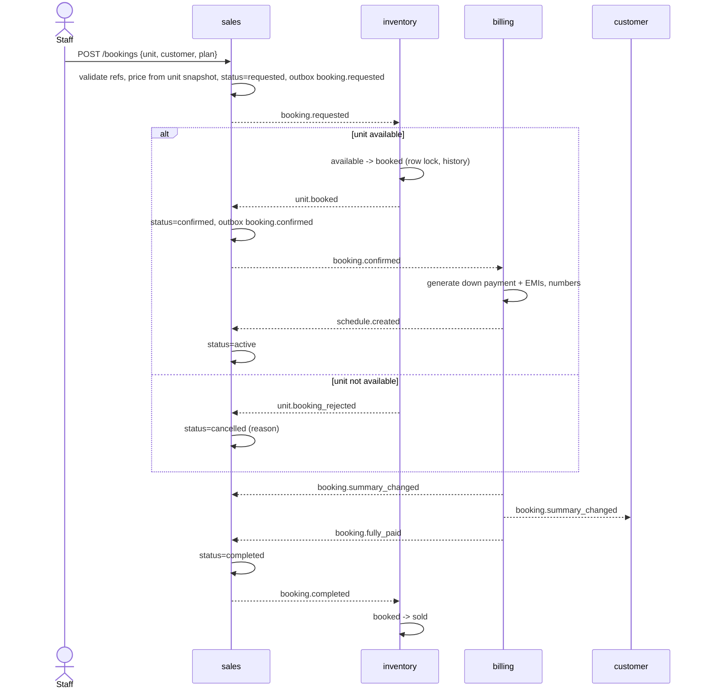

Cancel before any payment: sales -> `booking.cancelled` -> inventory releases the unit, billing cancels open invoices, contract voids open documents.

### 5.2 Taking a payment (one billing transaction)

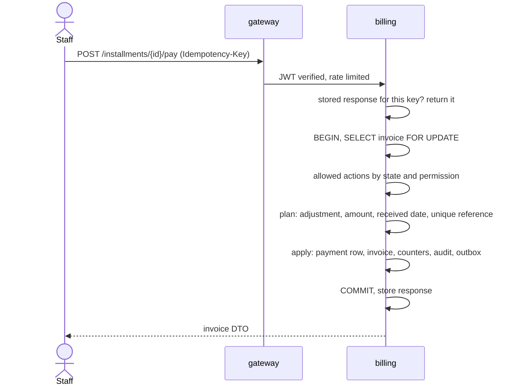

Card: `POST payment-intents` creates an intent through the gateway port. The card is confirmed with
the provider outside our API. `POST card-payments` then verifies the intent and runs the same
apply step. A unique `(tenant_id, stripe_intent_id)` makes replays harmless.

### 5.3 Fine rate change

Most specific wins: customer+category, customer, unit, project+category, project, default+category,
default. Saving or deleting a rule re-prices **unpaid overdue** invoices only. Project, customer and
unit rules re-price in the same transaction through a set-based `UPDATE` scoped by the snapshot
columns `project_id`, `customer_id`, `unit_id`. A default or default+category rule emits
`fine_rate.changed`; the billing worker re-prices the tenant in keyset batches of 5,000, so no request
holds a tenant-wide lock. Paid invoices keep the fine they were charged.

### 5.4 Daily status sweep

A billing worker (one replica wins a Postgres advisory lock) runs a set-based `UPDATE`:
scheduled past due date becomes due, due past the grace days becomes overdue, then re-prices
the fine of newly overdue invoices and emits `booking.summary_changed` for affected bookings.

## 6. State machines (the server is the truth, the UI renders `allowed_actions`)

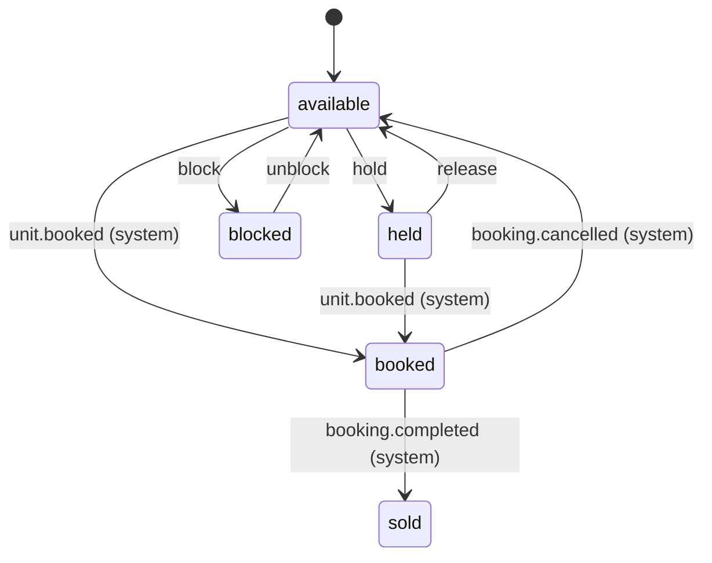

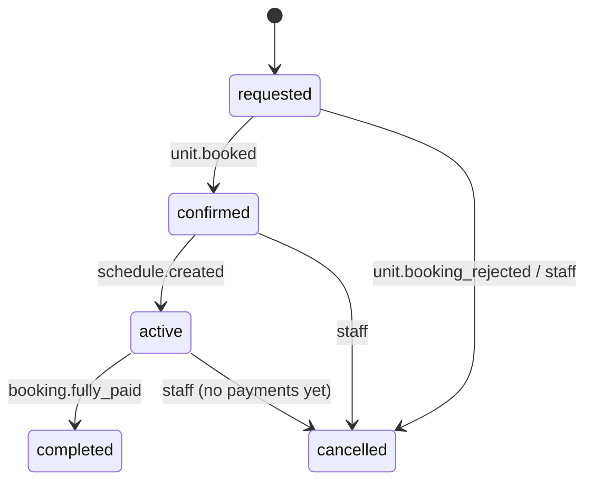

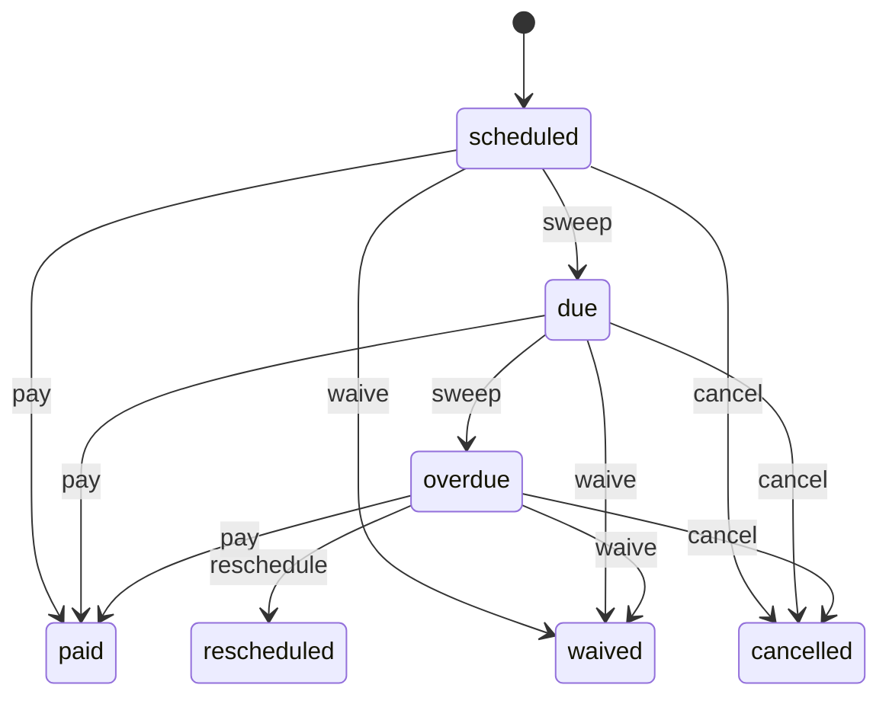

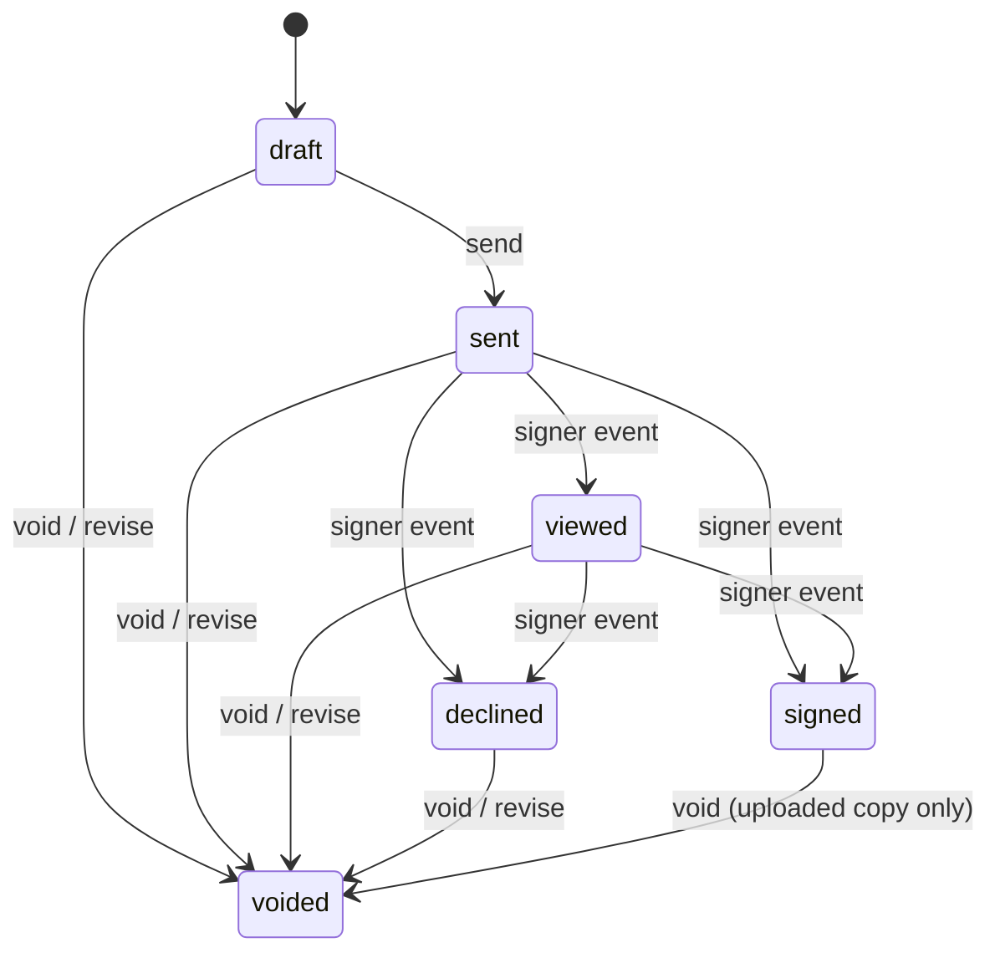

## 7. Data model and constraints

Single file: `Backend/db/estateops.sql`. Conventions on every table: `id uuid` generated by the app,
`tenant_id uuid not null`, `created_at` and `updated_at timestamptz`, `version int` on mutable
aggregates. Money is `bigint` minor units with `char(3)` currency. Enums are `text` with
`CHECK ... IN (...)`. Every index leads with `tenant_id`. Each schema also has `outbox`,
`processed_event`, `idempotency_key` and `audit_log`.

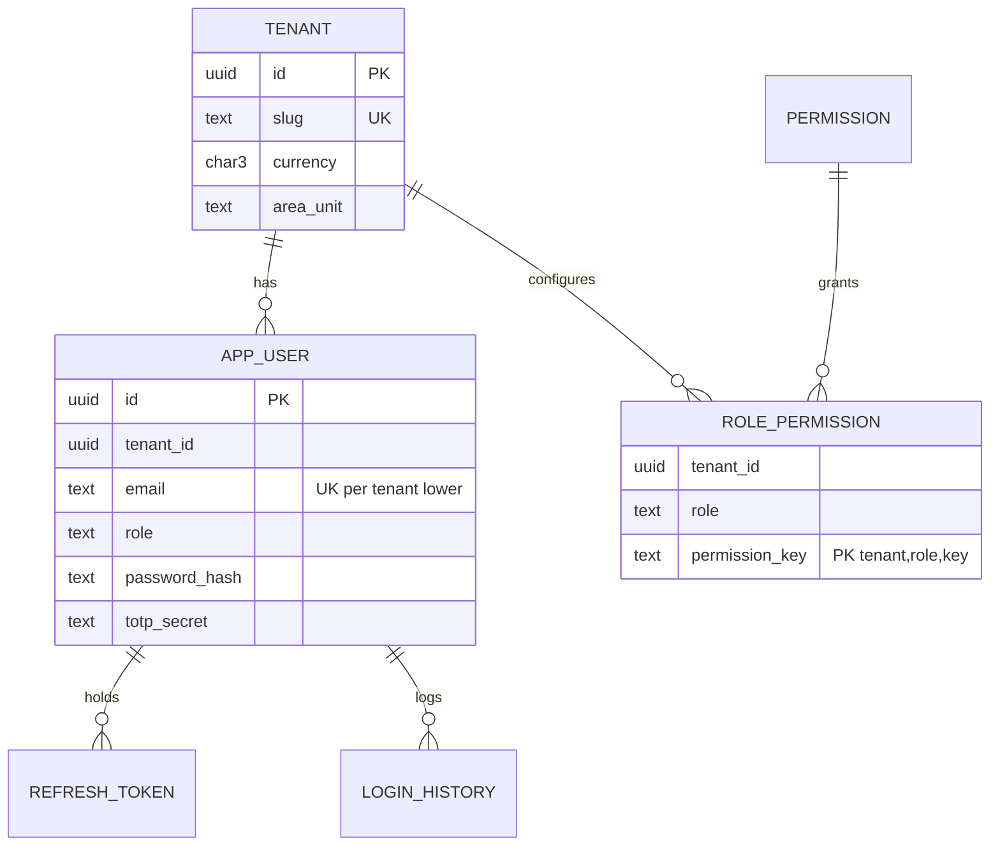

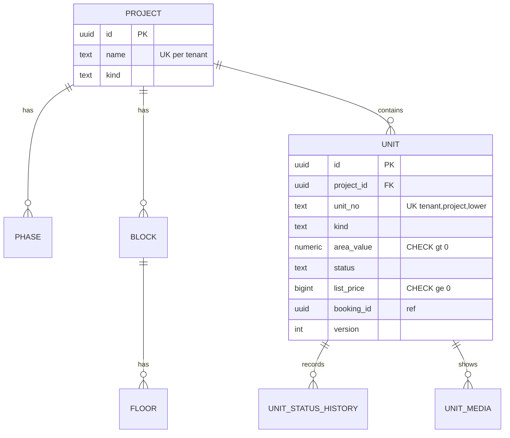

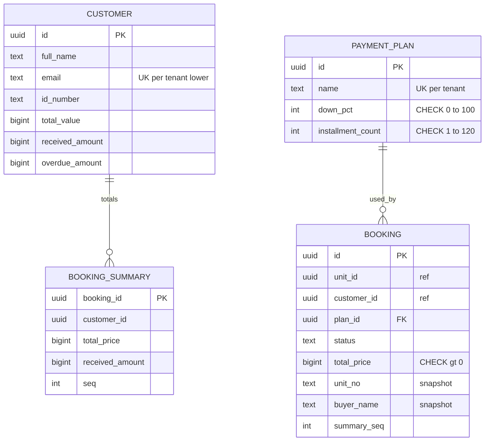

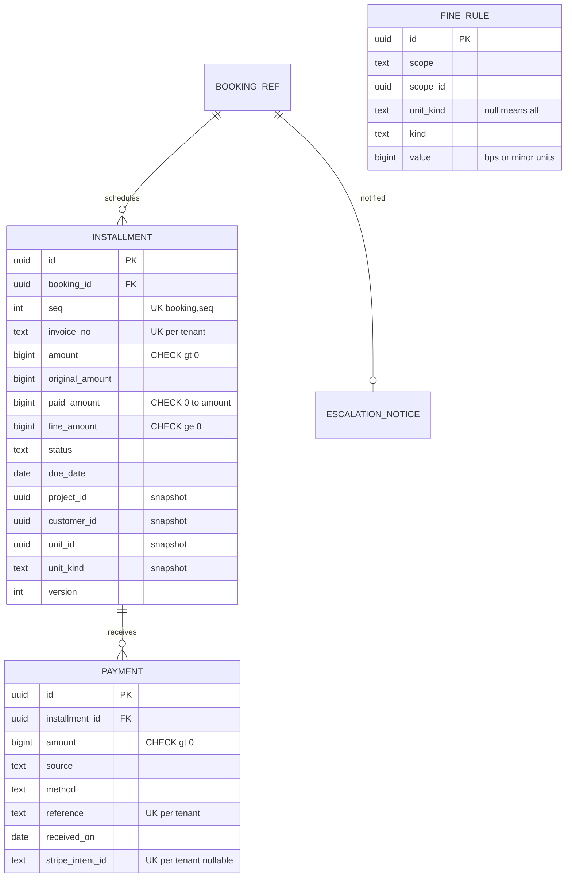

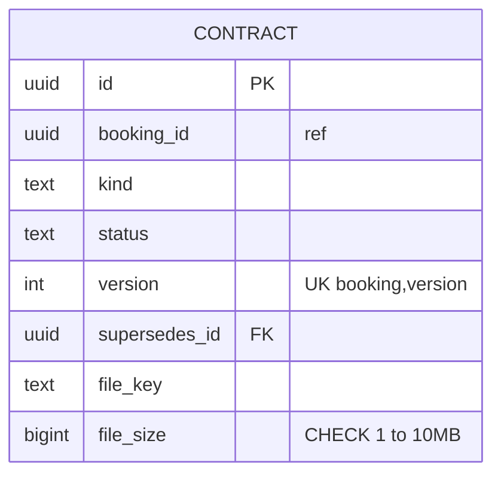

### Constraint catalogue

| Constraint                                                                               | Where                                | Protects                                          |
| ---------------------------------------------------------------------------------------- | ------------------------------------ | ------------------------------------------------- |
| unique `(tenant_id, lower(email))`                                                       | identity.app_user, customer.customer | one account and one customer per email per tenant |
| unique `(tenant_id, project_id, lower(unit_no))`                                         | inventory.unit                       | unit number unique in a project                   |
| unique `(unit_id)` where status in requested, confirmed, active, completed               | sales.booking                        | a unit is never booked twice                      |
| unique `(booking_id, seq)`, `(tenant_id, invoice_no)`                                    | billing.installment                  | no duplicate schedule or invoice number           |
| unique `(tenant_id, reference)`, `(tenant_id, stripe_intent_id)`                         | billing.payment                      | no reused reference, a card intent books once     |
| unique expression index on `(tenant_id, scope, coalesce(scope_id), coalesce(unit_kind))` | billing.fine_rule                    | one rate per level and category                   |
| unique `(booking_id)` where signed; unique `(booking_id)` where open PandaDoc            | contract.contract                    | one signed contract, one open contract            |
| checks on money, percentages, enum lists, scope rules                                    | all schemas                          | invalid data cannot be stored                     |
| foreign keys `ON DELETE RESTRICT` inside a schema                                        | all schemas                          | no orphans. None across schemas                   |

## 8. API map and gateway routing

All paths are under `/api/v1/admin`, JSON snake_case, cursor pagination `{ data, next_cursor }`,
errors `{ code, message, details: [{ field, message }] }`, writes carry `Idempotency-Key`.

| Prefix                                                                           | Service   |
| -------------------------------------------------------------------------------- | --------- |
| `/auth`, `/users`, `/permissions`, `/tenant`                                     | identity  |
| `/projects`, `/units`, `/phases`, `/blocks`, `/floors`                           | inventory |
| `/customers`                                                                     | customer  |
| `/payment-plans`, `/bookings` (except `/bookings/{id}/contracts/*`)              | sales     |
| `/installments`, `/fine-rules`, `/escalations`, `/stats`, `/collection-settings` | billing   |
| `/contracts`, `/bookings/{id}/contracts/*`                                       | contract  |

Full endpoint list: `docs/api-contract.md`.

## 9. Security

- JWT RS256, 15 minute access token, rotating refresh token (hash stored). Every service verifies
  locally with the public key. Claims: `sub`, `tenant_id`, `role`, `permissions`, `name`.
- Permissions are enforced in each service (`requirePermission`). The gateway only authenticates.
- Internal endpoints (`/internal/*`) require `x-internal-token` (shared secret) and are not routed
  by the gateway.
- Passwords: scrypt with per-user salt. 2FA: TOTP (RFC 6238).
- Tenant id always comes from the token, never from the request body or path.
- Customer ID numbers are masked in every response.
- Role changes reach a user at the next token refresh (at most 15 minutes).

## 10. Scaling to 100K users

- Stateless services behind a load balancer, 3+ replicas each; billing and inventory scale highest.
- Small pool per replica, PgBouncer (transaction mode) before PostgreSQL; read replica for lists
  and stats (`READ_DATABASE_URL`, falls back to the primary).
- Keyset pagination only (opaque cursor holds the sort value and id), never `OFFSET`.
- Index shapes: `installment(tenant_id, status, due_date)`, `(tenant_id, customer_id, due_date)`,
  `(tenant_id, project_id, status)`, `unit(tenant_id, project_id, status, kind)`.
- Partitioning, applied when volume needs it (kept out of the single file so it stays portable):
  `billing.installment`, `billing.payment` and audit tables hash-partitioned by `tenant_id` (32
  partitions) or ranged by month.
- Hot spots: invoice-number counters are one row per tenant (`UPDATE ... RETURNING`), fine
  re-pricing is scoped and batched, the sweep is set-based under an advisory lock.
- Consistency window: relay polls every 500 ms, so cross-service views settle in about a second.
- Sizing guide: 7 services x 3 replicas, pool of 10 per replica (210 connections) behind PgBouncer
  into a 16 vCPU primary plus one replica handles the stated load with headroom.

## 11. Failure modes

| Failure                      | Behaviour                                                                              |
| ---------------------------- | -------------------------------------------------------------------------------------- |
| Consumer down                | outbox rows stay unpublished or retry with backoff, then dead letter. Nothing is lost. |
| Duplicate or reordered event | `processed_event` skips duplicates. `seq` and upserts keep order-safe.                 |
| Retried request              | `Idempotency-Key` returns the stored response, constraints block double effects.       |
| Two staff pay one invoice    | `SELECT ... FOR UPDATE` serializes. The second sees the new balance.                   |
| Unit booked twice            | unique partial index on `sales.booking(unit_id)` and inventory row lock.               |
| Card charged, record fails   | the intent stays `succeeded`, retry of `card-payments` records it once.                |
| Database failover            | services reconnect. Idempotent writes make client retries safe.                        |

## 12. Not in this phase

Real Stripe, PandaDoc, Google sign-in, email and SMS, S3, a message broker, Redis caches, row-level
security by `app.tenant_id`, a read-model service for stats, per-service databases. Each has a port or
a documented seam so adding it does not change domain code.
